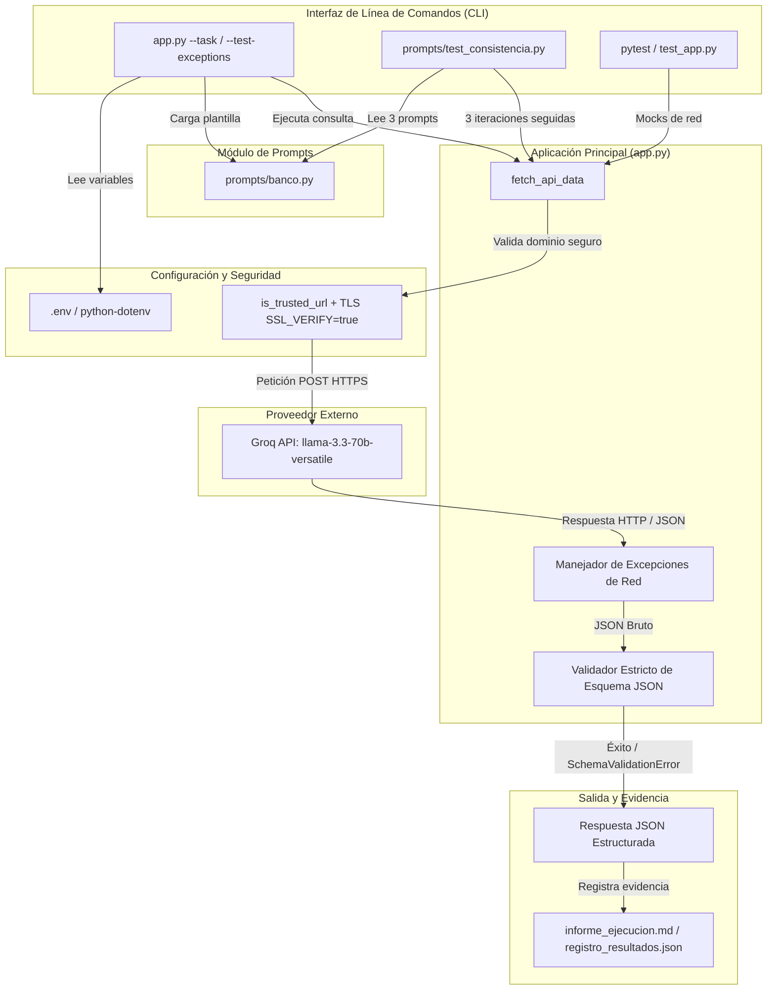
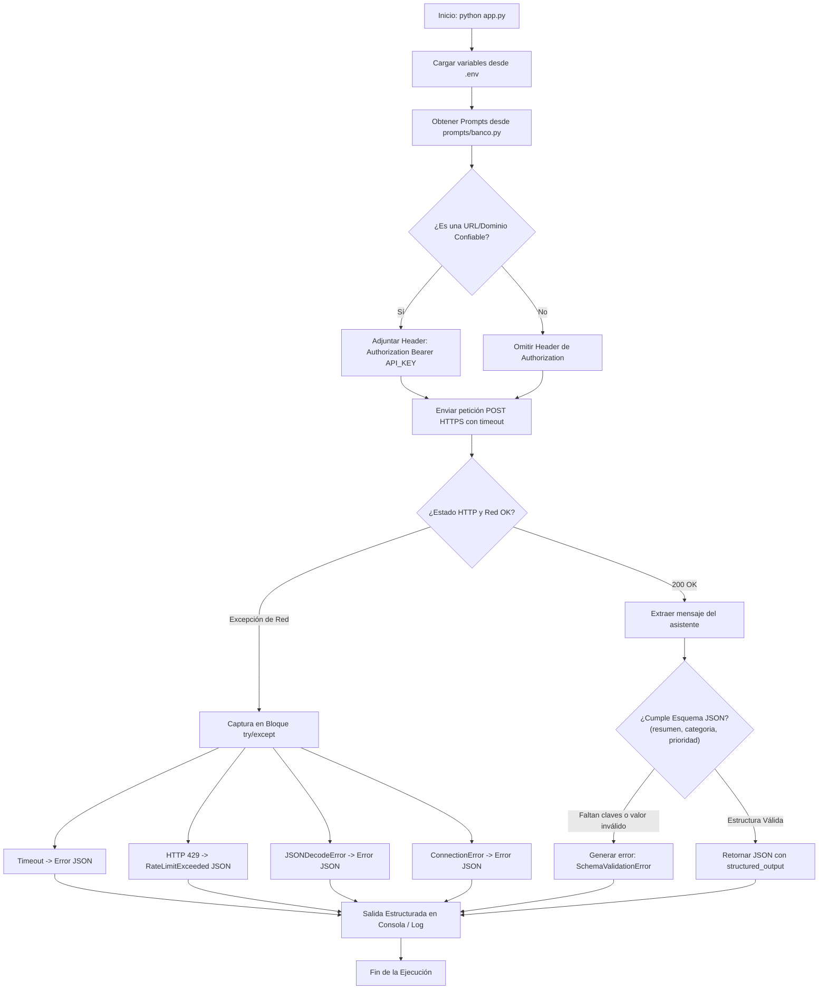

# Bienvenidos a mi primera práctica en Git y GitHub

¡Hola! Esta es la presentación oficial de mi repositorio utilizando Git y GitHub con un entorno virtual en Python.


---

# Proyecto: Consumo de API de IA Generativa con Salida JSON Estructurada en Entorno Virtual Python

Proyecto configurado con entorno virtual (`.venv`), control de dependencias con `requirements.txt`, gestión de variables de entorno mediante `python-dotenv`, y consumo robusto de APIs de IA Generativa (como Groq u OpenRouter con el modelo `llama-3.3-70b-versatile`) a través de `requests` con salida forzada y estructurada en JSON (`response_format: {"type": "json_object"}`) y gestión integral de excepciones.

---

## 📌 Guía de Evaluación Paso a Paso (100% Offline / Sin API Key)

Si eres evaluador y **no dispones de una API Key de Groq**, el proyecto está completamente preparado para ser verificado en un entorno local y aislado. No se requiere conexión a la API real ni saldo en proveedores de IA para validar el 100% de la rúbrica del Gate 1.

Sigue estos pasos en tu terminal para ejecutar las pruebas:

### Paso 1: Clonar el repositorio y preparar el entorno virtual

```bash
# 1. Clonar el repositorio e ingresar a la carpeta
git clone https://github.com/cfpdiaz/practicas_de_git.git
cd practicas_de_git

# 2. Crear y activar el entorno virtual
python -m venv .venv

# En Windows (PowerShell):
.\.venv\Scripts\Activate.ps1

# En Linux/macOS:
source .venv/bin/activate

# 3. Instalar las dependencias
pip install -r requirements.txt
```

### Paso 2: Configurar el archivo de variables de entorno (`.env`)

Copia la plantilla de ejemplo para generar tu archivo `.env` local:

```bash
# En Windows (PowerShell):
Copy-Item .env.example .env

# En Linux/macOS o Git Bash:
cp .env.example .env
```

> **Nota:** Mantén la variable `API_KEY=tu_groq_api_key_aqui` tal como viene por defecto. Al detectar este valor placeholder, la aplicación activa automáticamente el modo de simulación offline defensivo.

### Paso 3: Probar la aplicación en modo simulación

Ejecuta el script principal para validar la respuesta estructurada:

```bash
python app.py
```

**Resultado esperado:** Retorna un objeto JSON con `status_code: 200`, el bloque `structured_output` con las llaves requeridas (`resumen`, `categoria`, `prioridad`) y las métricas de tokens simuladas en `data.usage`.

### Paso 4: Ejecutar la suite de pruebas unitarias (pytest)

Valida el comportamiento del código, los mocks de red y las reglas de negocio ejecutando:

```bash
pytest -ra
```

**Resultado esperado:** `6 passed` (0 fallos). Esta suite utiliza `unittest.mock` para probar respuestas HTTP exitosas, manejo de errores y validación de esquema de forma 100% offline.

### Paso 5: Probar la batería de excepciones y seguridad

Verifica cómo el sistema intercepta fallos de red y protege las credenciales ejecutando:

```bash
python app.py --test-exceptions
```

**Resultado esperado:** Muestra en pantalla la captura controlada de 4 escenarios: petición estándar exitosa (`200 OK`), `Timeout`, `RateLimitExceeded` (HTTP 429) y `JSONDecodeError`. Los escenarios de HTTP 429 y HTML plano consultan `httpbin.org`, por lo que requieren conexión a internet; el caso `ConnectionError` está cubierto en la suite de [`test_app.py`](test_app.py). La función `is_trusted_url` garantiza que no se exfiltre la clave de autorización hacia hosts no confiables.

### Paso 6: Revisar las evidencias de certificación registradas

Para verificar la consistencia obtenida en ejecuciones reales previas contra la red de Groq, puedes consultar los siguientes archivos del repositorio:

- [`informe_ejecucion.md`](informe_ejecucion.md): registro detallado de trazas HTTP, códigos de respuesta y consumo real de tokens.
- [`prompts/registro_resultados.json`](prompts/registro_resultados.json): evidencia de la prueba de consistencia (9/9 ejecuciones válidas contra los 3 prompts del banco).
- [`REPORTE_VERIFICACION_FINAL.md`](REPORTE_VERIFICACION_FINAL.md): informe consolidado de la auditoría técnica.

---

## 📊 Diagramas de Arquitectura y Flujo (Mermaid)

### 1. Flujo de Consumo, Seguridad y Excepciones



### 2. Diagrama de Flujo de Ejecución



---

## 📋 Requisitos Previos

- **Python**: Versión 3.10 o superior (probado y validado en Python 3.12).
- **Git**: Para el control de versiones.
- **PowerShell**, **CMD** o terminal compatible (Windows / Linux / macOS).

---

## 📁 Estructura del Proyecto

```text
├── .git/                 # Historial y metadatos de Git
├── .venv/                # Entorno virtual aislado (ignorado por Git)
├── .env                  # Variables de entorno locales sensibles (ignorado por Git)
├── .env.example          # Plantilla de variables de entorno recomendadas
├── .gitattributes        # Normalización de saltos de línea (LF/CRLF)
├── .gitignore            # Exclusión de archivos temporales, .env y .venv
├── claudio_md.jpg        # Imagen de presentación
├── main.py               # Script de verificación básica del entorno
├── app.py                # Script principal de consumo de API de IA estructurado
├── requirements.txt      # Registro congelado de dependencias del proyecto
├── test_app.py           # Suite de pruebas unitarias aisladas con mocks
├── prompts/              # Banco de prompts estructurados y pruebas de consistencia (Gate 1)
│   ├── __init__.py       # Inicializador del paquete prompts
│   ├── banco.py          # Definición del banco de prompts (BANCO_DE_PROMPTS)
│   ├── test_consistencia.py # Ejecutor de iteraciones y validación de contrato JSON
│   └── registro_resultados.json # Evidencia generada automáticamente (meta 3/3)
└── README.md             # Documentación general y registro de instalación
```

---

## ⚙️ Guía Paso a Paso de Instalación y Ejecución

### 1. Clonar el repositorio e ingresar al directorio

```bash
git clone <URL_DE_TU_REPOSITORIO>
cd <NOMBRE_DE_LA_CARPETA>
```

### 2. Crear el Entorno Virtual (`.venv`)
Si no existe un entorno previo, créalo utilizando el módulo `venv` de Python:
```powershell
python -m venv .venv
```

### 3. Activar el Entorno Virtual
- **PowerShell (Windows):**
  ```powershell
  .\.venv\Scripts\Activate.ps1
  ```
  *(Nota: Si PowerShell restringe la ejecución de scripts, ejecuta previamente `Set-ExecutionPolicy -ExecutionPolicy RemoteSigned -Scope CurrentUser`)*.

- **Símbolo del sistema / CMD (Windows):**
  ```cmd
  .venv\Scripts\activate.bat
  ```

- **Linux / macOS:**
  ```bash
  source .venv/bin/activate
  ```

### 4. Instalar las Dependencias
Con el entorno virtual activado, instala las librerías requeridas registradas en `requirements.txt`:
```powershell
pip install -r requirements.txt
```

### 5. Configurar Variables de Entorno
Copia la plantilla `.env.example` a un archivo `.env`:
```powershell
Copy-Item .env.example .env
```
Configura las variables según tu proveedor de IA:
```ini
APP_ENV=development
DEBUG=True
API_BASE_URL=https://api.groq.com/openai/v1
API_TIMEOUT=10.0
SSL_VERIFY=true
API_KEY=tu_groq_api_key_aqui
```

### 6. Ejecutar los Scripts

#### A. Verificación del Entorno (`main.py`)
```powershell
python main.py
```
*Salida esperada:*
```text
¡Entorno virtual y proyecto configurados correctamente!
Versión de Python: 3.12.x ...
```

#### B. Procesamiento de Texto con Modelo de IA (`app.py`)
Ejecuta la consulta enviando el prompt de usuario o seleccionando una tarea predefinida al modelo de IA generativa (`llama-3.3-70b-versatile`):
```powershell
python app.py --task incidente_tecnico
```
O de forma directa:
```powershell
python app.py
```
*Salida estructurada en JSON esperada:*
```json
{
  "success": true,
  "status": "success",
  "status_code": 200,
  "url": "https://api.groq.com/openai/v1/chat/completions",
  "timestamp": "2026-10-22T05:00:00.000000+00:00",
  "data": {
    "id": "chatcmpl-7d2d3a1f9e2b4c8a91b2c3d4e5f6a7b8",
    "object": "chat.completion",
    "created": 1729573200,
    "model": "llama-3.3-70b-versatile",
    "choices": [
      {
        "index": 0,
        "message": {
          "role": "assistant",
          "content": "{\"resumen\": \"Sobrecarga crítica de CPU en el servidor de base de datos de producción afectando la latencia de los usuarios.\", \"categoria\": \"Infraestructura\", \"prioridad\": \"alta\"}"
        },
        "finish_reason": "stop"
      }
    ],
    "usage": {
      "prompt_tokens": 78,
      "completion_tokens": 34,
      "total_tokens": 112
    }
  },
  "structured_output": {
    "resumen": "Sobrecarga crítica de CPU en el servidor de base de datos de producción afectando la latencia de los usuarios.",
    "categoria": "Infraestructura",
    "prioridad": "alta"
  }
}
```

También es posible pasar un prompt personalizado mediante la línea de comandos:
```powershell
python app.py --prompt "Se detectó un fallo intermitente en la pasarela de pagos con código 502 Bad Gateway."
```

#### C. Batería de Pruebas de Excepciones
`app.py` incluye un parámetro para comprobar en tiempo real el manejo estructurado de excepciones (Timeout, HTTP 429 con Rate Limits y JSONDecodeError):
```powershell
python app.py --test-exceptions
```

#### D. Prueba de Consistencia del Banco de Prompts (Gate 1)
Ejecuta la prueba de consistencia estructurada que valida 3 iteraciones por cada prompt del banco oficial contra la API:
```powershell
python -m prompts.test_consistencia
```

### 7. Desactivar el Entorno Virtual
Cuando termines de trabajar en el proyecto:
```powershell
deactivate
```

---

## 🛡️ Manejo de Excepciones en `app.py`

El script implementa un bloque de control de excepciones exhaustivo mediante `requests.exceptions`:

| Excepción | Causa Simulada / Real | Código HTTP | Formato de Salida |
| :--- | :--- | :--- | :--- |
| `Timeout` | Servidor tarda más que `API_TIMEOUT` | `null` | JSON con `"error_type": "Timeout"` y detalle |
| `HTTPError (Rate Limit)` | Límite de peticiones alcanzado | `429` | JSON con `"error_type": "RateLimitExceeded"` y `Retry-After` |
| `HTTPError (General)` | Códigos de error de cliente o servidor | `4xx / 5xx` | JSON con `"error_type": "HTTPError"` y código de estado |
| `JSONDecodeError` | La API responde HTML o texto no parseable | `200` u otro | JSON con `"error_type": "JSONDecodeError"` y posición |
| `ConnectionError` | Falla de resolución DNS o red caída | `null` | JSON con `"error_type": "ConnectionError"` |
| `RequestException` | Fallback para cualquier anomalía de red | `null` | JSON con `"error_type": "RequestException"` |

---

## 🧪 Registro de la Prueba de Instalación Limpia (Clean Install Log)

A continuación se documenta el ciclo de validación de instalación desde un estado limpio:

1. **Creación del entorno virtual aislado:**
   ```powershell
   python -m venv .venv
   ```
   *Resultado:* Creación correcta del árbol `.venv/` con `python.exe` y `pip 24.2`.

2. **Instalación de paquetes con `pip install -r requirements.txt`:**
   ```text
   Collecting certifi==2026.10.19 (from -r requirements.txt (line 5))
   Collecting charset-normalizer==3.5.2 (from -r requirements.txt (line 6))
   Collecting idna==3.20 (from -r requirements.txt (line 7))
   Collecting python-dotenv==1.2.4 (from -r requirements.txt (line 8))
   Collecting requests==2.34.2 (from -r requirements.txt (line 9))
   Collecting urllib3==2.8.0 (from -r requirements.txt (line 10))
   Installing collected packages: urllib3, python-dotenv, idna, charset-normalizer, certifi, requests
   Successfully installed certifi-2026.10.19 charset-normalizer-3.5.2 idna-3.20 python-dotenv-1.2.4 requests-2.34.2 urllib3-2.8.0
   ```

3. **Verificación de dependencias instaladas (`pip list`):**
   ```text
   Package            Version
   ------------------ ----------
   certifi            2026.10.19
   charset-normalizer 3.5.2
   idna               3.20
   pip                24.2
   python-dotenv      1.2.4
   requests           2.34.2
   urllib3            2.8.0
   ```

4. **Verificación de ejecución de scripts:**
   - `python main.py`: Ejecución exitosa reconociendo el intérprete Python 3.12.
   - `python app.py`: Consumo de endpoint REST completado con código `200 OK` y serialización JSON.
   - `python app.py --test-exceptions`: 4 casos validados (`Petición exitosa`, `Timeout`, `HTTP 429 RateLimitExceeded`, `JSONDecodeError`).

5. **Verificación de Git e ignorado de credenciales:**
   - Comando: `git check-ignore -v .env`
   - Salida: `.gitignore:38:.env   .env`
   - El archivo `.env` permanece completamente aislado y protegido contra subidas accidentales a repositorios remotos.

---

## 🗂️ Banco de Prompts y Prueba de Consistencia (Gate 1)

Para satisfacer los requisitos de habilitación técnica del **Gate 1**, se implementó la arquitectura modular del **Banco de Prompts** y la batería automatizada de **Prueba de Consistencia** dentro del paquete `prompts/`.

### 1. Estructura de la Carpeta `prompts/`

```text
prompts/
├── __init__.py               # Inicializador del paquete Python
├── banco.py                  # Definición oficial de BANCO_DE_PROMPTS
├── test_consistencia.py      # Script de prueba y evaluación de consistencia
└── registro_resultados.json  # Evidencia generada automáticamente (meta 3/3)
```

### 2. Definición del Banco de Prompts (`prompts/banco.py`)

La variable `BANCO_DE_PROMPTS` contiene tres combinaciones estructuradas con instrucciones de sistema rigurosas, ejemplos reales y esquemas de llaves obligatorias:

| Nombre | Propósito | Claves Esperadas | Esquema / Enums |
| :--- | :--- | :--- | :--- |
| `clasificar_incidente` | Clasificación y triaje de incidentes de TI | `resumen`, `categoria`, `prioridad` | `prioridad`: `"alta" \| "media" \| "baja"` |
| `analisis_sentimiento_soporte` | Análisis de sentimiento y urgencia en soporte | `resumen`, `sentimiento`, `urgencia` | `sentimiento`: `"positivo" \| "neutral" \| "negativo"`, `urgencia`: `"alta" \| "media" \| "baja"` |
| `extraccion_entidades_logistica` | Extracción de datos de pedidos y envíos | `numero_pedido`, `destino`, `estado_envio` | `estado_envio`: `"pendiente" \| "en_transito" \| "entregado"` |

Cada entrada fuerza la respuesta en modo `JSON Object` estricto sin delimitadores markdown ni explicaciones adicionales fuera del contrato.

### 3. Procedimiento para Ejecutar la Prueba de Consistencia

Con el entorno virtual activado, ejecuta el módulo desde la raíz del proyecto:

```powershell
python -m prompts.test_consistencia
```

#### ¿Qué realiza este script?
1. **Importación directa:** Importa la función de consumo `fetch_api_data` desde `app.py` y `BANCO_DE_PROMPTS` desde `prompts.banco`.
2. **Iteraciones continuas:** Ejecuta **3 iteraciones consecutivas** por cada prompt del banco contra la API.
3. **Validación de contrato:** En cada intento verifica:
   - Que el código de respuesta HTTP sea exitoso (`200 OK`).
   - Que la salida sea deserializable como un objeto JSON válido (`dict`).
   - Que contenga estrictamente todas las `claves_esperadas` definidas en el contrato.
4. **Cálculo de métricas:** Calcula la tasa de éxito por prompt individual y la tasa global de consistencia.
5. **Persistencia de evidencia:** Guarda automáticamente los resultados en `prompts/registro_resultados.json` con fecha, hora, detalles por iteración y verificación del cumplimiento de la meta (3/3).

### 4. Evidencia de Ejecución Obtenida

Salida de la ejecución de `python -m prompts.test_consistencia`:

```text
=================================================================
 PRUEBA DE CONSISTENCIA - BANCO DE PROMPTS (GATE 1)
=================================================================
 Fecha y hora local: 2026-10-22 04:11:32
 Total de prompts a evaluar: 3
 Iteraciones por prompt:     3
=================================================================

[1/3] Evaluando prompt: 'clasificar_incidente'
      Descripción: Clasificación y triaje de incidentes de TI
      Claves esperadas: ['resumen', 'categoria', 'prioridad']
  - Iteración 1/3: OK
  - Iteración 2/3: OK
  - Iteración 3/3: OK
  --> Resultado 'clasificar_incidente': 3/3 (100.0%) - Consistente: SÍ

[2/3] Evaluando prompt: 'analisis_sentimiento_soporte'
      Descripción: Análisis de sentimiento y urgencia en reclamos de clientes
      Claves esperadas: ['resumen', 'sentimiento', 'urgencia']
  - Iteración 1/3: OK
  - Iteración 2/3: OK
  - Iteración 3/3: OK
  --> Resultado 'analisis_sentimiento_soporte': 3/3 (100.0%) - Consistente: SÍ

[3/3] Evaluando prompt: 'extraccion_entidades_logistica'
      Descripción: Extracción estructurada de datos de pedidos o despachos
      Claves esperadas: ['numero_pedido', 'destino', 'estado_envio']
  - Iteración 1/3: OK
  - Iteración 2/3: OK
  - Iteración 3/3: OK
  --> Resultado 'extraccion_entidades_logistica': 3/3 (100.0%) - Consistente: SÍ

=================================================================
 RESUMEN GENERAL DE CONSISTENCIA
=================================================================
 Total ejecuciones:       9
 Ejecuciones válidas:     9
 Ejecuciones fallidas:    0
 Tasa de éxito global:    9/9 (100.0%)
 Meta (3/3 por prompt):   CUMPLIDA CON ÉXITO
 Registro guardado en:    prompts/registro_resultados.json
=================================================================
```

El archivo `prompts/registro_resultados.json` queda registrado con la estructura:

```json
{
  "fecha": "2026-10-22",
  "hora": "04:11:32",
  "timestamp_iso": "2026-10-22T07:11:32.372319+00:00",
  "resumen_ejecucion": {
    "total_prompts": 3,
    "iteraciones_por_prompt": 3,
    "total_ejecuciones": 9,
    "ejecuciones_validas": 9,
    "ejecuciones_fallidas": 0,
    "tasa_exito_global": "9/9 (100.0%)",
    "meta_3_de_3_cumplida": true
  },
  "detalle_por_prompt": [ ... ]
}
```

## Auditoría Técnica con DeepSeek Harness

Para garantizar el cumplimiento del 100% de la rúbrica del Gate 1, el repositorio fue sometido a una auditoría técnica automatizada utilizando el siguiente prompt de evaluación estricta:

<details>
<summary><b>Ver Prompt de Auditoría DeepSeek Harness</b></summary>

```text
Actúa como un Auditor Técnico Principal y Senior Engineer especializado en Desarrollo de Software con IA en Python...
[Actúa como un Auditor Técnico Principal y Senior Engineer especializado en Desarrollo de Software con IA en Python. Tu objetivo es realizar una auditoría rigurosa, defensiva e integral del repositorio para verificar el cumplimiento del 100% de la rúbrica del Gate 1.

Ejecuta y verifica punto por punto los siguientes requerimientos técnicos:

1. Dimensión Python y Código (20%):
   - Evalúa la arquitectura modular y limpia de `app.py`.
   - Ejecuta en terminal: `pytest -ra`
   - Confirma que la suite de pruebas unitarias (`test_app.py`) obtenga `6 passed, 0 failed, 0 xfailed` utilizando mocks de red y validación estricta de esquema.

2. Dimensión Consumo de API (25%):
   - Ejecuta: `python app.py`
   - Valida la conexión HTTP estructurada vía `requests` hacia el endpoint `/chat/completions`.
   - Comprueba que la respuesta parsee correctamente `structured_output` (`resumen`, `categoria`, `prioridad`) y preserve la metadata de consumo en `data.usage` (`prompt_tokens`, `completion_tokens`, `total_tokens`).

3. Dimensión Manejo de Excepciones y Resiliencia (Consumo API / Código):
   - Ejecuta: `python app.py --test-exceptions`
   - Verifica la interceptación y encapsulación en JSON de los errores:
     * `Timeout` (forzado con `timeout=0.001`).
     * `RateLimitExceeded` (HTTP 429).
     * `JSONDecodeError` (respuestas HTML no parseables).
     * `ConnectionError`.
   - Asegura la navegación defensiva dentro del payload utilizando validaciones `isinstance()`.

4. Dimensión Seguridad y Credenciales (10%):
   - Valida la función anti-exfiltración `is_trusted_url` para garantizar que el encabezado `Authorization: Bearer <API_KEY>` NO sea enviado a hosts externos no confiables (ej. `httpbin.org`).
   - Revisa que `SSL_VERIFY=true` sea obligatorio en `.env` y `.env.example`.
   - Ejecuta `git check-ignore -v .env` y `git status` para certificar que ni `.env` ni `.venv` sean rastreados por Git.

5. Dimensión Prompt y Respuesta (15%):
   - Inspecciona `prompts/banco.py` (mínimo 3 prompts estructurados con contrato JSON).
   - Ejecuta: `python -m prompts.test_consistencia`
   - Comprueba que se ejecuten 3 iteraciones consecutivas por cada prompt y se actualice `prompts/registro_resultados.json` confirmando un 100% de éxito (9/9 ejecuciones válidas).

6. Dimensión Entorno y Repositorio (10%):
   - Verifica la existencia de `.venv`, `requirements.txt` con versiones fijadas, `.env.example`, `informe_ejecucion.md` y `README.md` (con diagramas Mermaid renderizables).

Entregable requerido:
Genera un informe de auditoría detallado en formato Markdown (`REPORTE_VERIFICACION_FINAL.md`) con la fecha, entorno, trazas de ejecución, análisis de seguridad y una tabla comparativa de resultados por cada una de las 6 dimensiones.]
```

</details>
